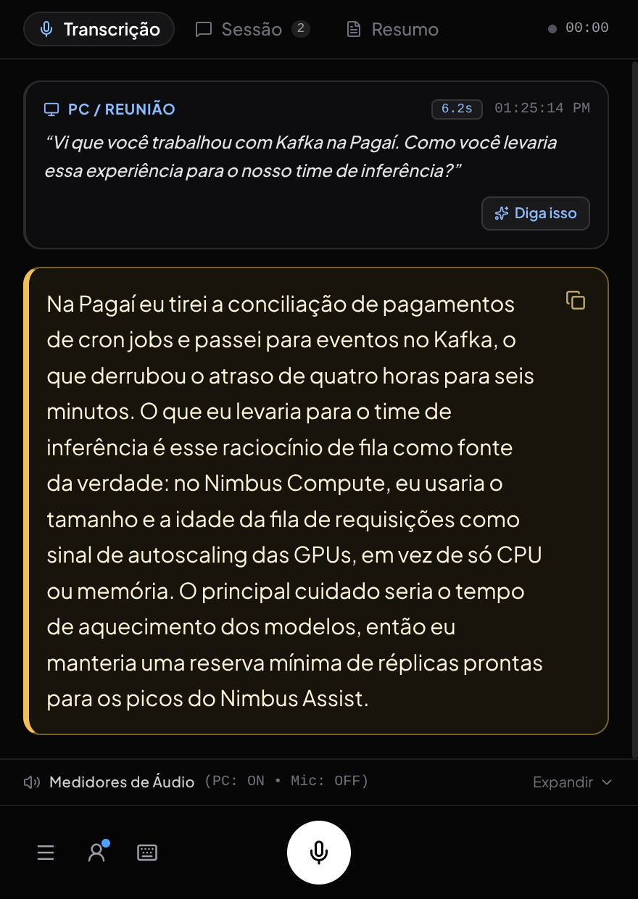
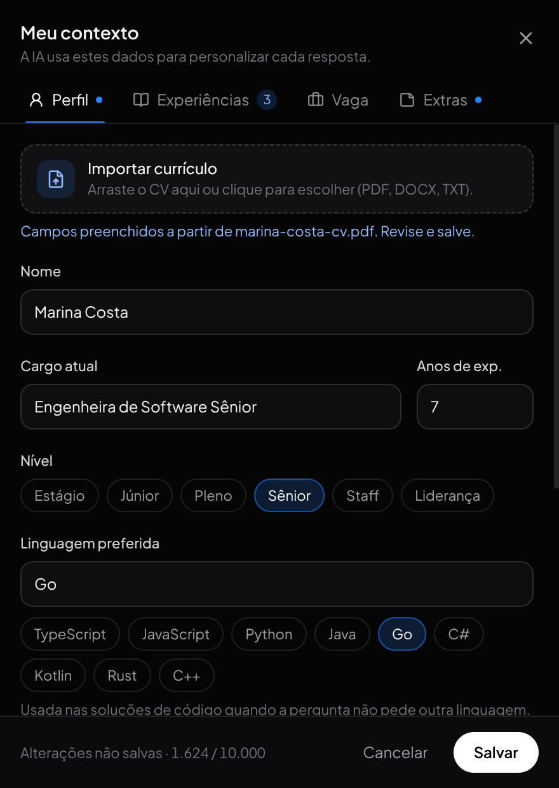
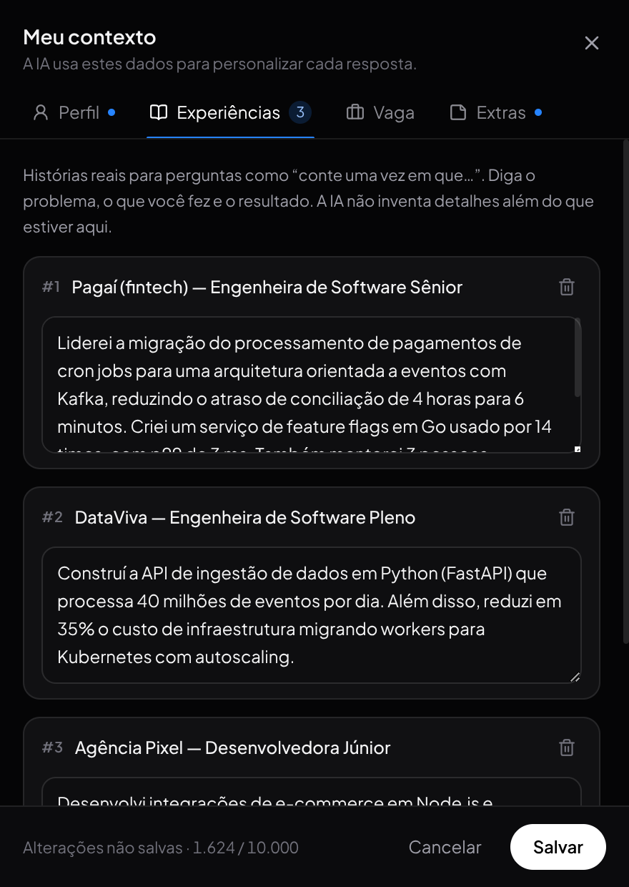
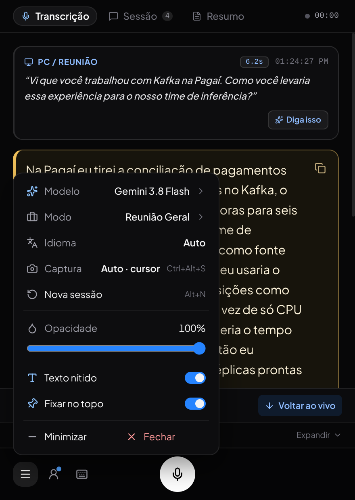
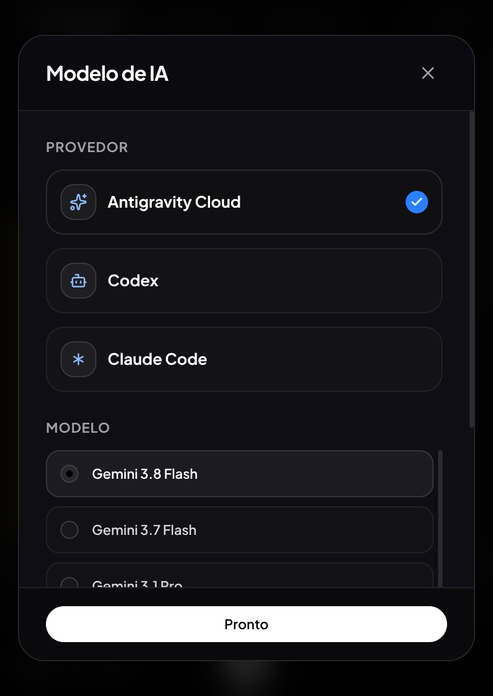

# InterviewAI

Copiloto desktop para entrevistas e reuniões, com transcrição de áudio e sugestões de resposta em uma janela flutuante. Roda no Linux e no Windows.

- Captura do áudio do PC (Linux e Windows) e gravação pelo microfone.
- Transcrição durante a fala; respostas automáticas após sua consolidação.
- **Importe seu currículo** (PDF, DOCX, TXT ou MD) arrastando o arquivo: a IA preenche perfil, tecnologias e experiências.
- **Contexto da vaga e da empresa**: produtos, stack e requisitos, importados da descrição da vaga ou escritos à mão, para respostas ligadas à entrevista daquele dia.
- Sugestões em tom profissional e conversacional, com contexto pessoal editável.
- Ctrl+Alt+S envia uma captura da tela (por exemplo, um exercício mostrado no PC) diretamente ao agente.
- Integração com os CLIs autenticados do Antigravity, do Codex e do Claude Code.

<p align="center">
  
</p>

| Currículo importado | Experiências | Vaga e empresa |
| :---: | :---: | :---: |
|  |  |  |

| Menu | Modelo de IA |
| :---: | :---: |
|  |  |

<sub>Capturas com dados fictícios de demonstração. O perfil e a vaga foram preenchidos pela importação de um currículo e de uma vaga fictícios.</sub>

## Requisitos

- **Linux** com PipeWire/PulseAudio (`pactl` e `parec`) para capturar o áudio do PC, ou **Windows 10/11** (o áudio do sistema é capturado pelo próprio app).
- Node.js **22.12+** e npm.
- Python 3 com `SpeechRecognition`. O `ffmpeg` é necessário no Linux e opcional no Windows.
- Pelo menos um dos CLIs (`agy`, `codex` ou `claude`) instalado e autenticado.
- `xrandr` (opcional, Linux/X11) para escolher o monitor da captura de tela pelo nome.
- Internet para o reconhecimento de voz e as respostas do provedor.

## Executar

```bash
git clone git@github.com:rabpaulo/Interview-AI.git
cd Interview-AI
npm ci
npm start
```

No Windows, instale antes o Python e a biblioteca de reconhecimento (PowerShell):

```powershell
py -m pip install SpeechRecognition
npm ci
npm start
```

O app encontra `agy`, `codex` e `claude` no `PATH` (no Windows, também os atalhos `.cmd` do npm). Se o CLI estiver em outro lugar, informe o caminho:

```bash
CLAUDE_BIN="$(command -v claude)" npm start
```

```powershell
$env:CLAUDE_BIN = (Get-Command claude).Source; npm start
```

Selecione o provedor correspondente em **Menu → Modelo**, no ícone ☰ da barra inferior. `npm start` inicia o frontend, abre o Electron e inicia ou reaproveita o backend na porta 3001. O áudio do PC tenta iniciar automaticamente.

Para instalar as dependências de áudio e entender os modos de execução, consulte o [guia de desenvolvimento](docs/development.md).

## Usar

1. No menu (☰) da barra inferior, escolha o modelo e o modo (tipo de entrevista).
2. Abra **Meu contexto**, no ícone de pessoa da barra inferior. Na aba **Perfil**, arraste seu currículo para **Importar currículo** (ou clique para escolher o arquivo); a IA preenche os campos e as experiências. Revise e ajuste.
3. Na aba **Vaga**, arraste a descrição da vaga ou preencha empresa, vaga e **Sobre a empresa e os produtos** (por exemplo: “faz produtos de IA generativa e uma plataforma de GPUs”). Salve. O perfil fica em `~/.local/share/interviewai/profile.json` (Linux) ou `%APPDATA%\InterviewAI\profile.json` (Windows) e persiste entre execuções.
4. Confira a captura nos medidores de áudio. No modo automático, as falas consolidadas do PC geram sugestões; use **Diga isso** em uma fala da transcrição ou Ctrl+D para solicitar uma manualmente.
5. Para enviar uma mensagem de voz ao agente, use o microfone ou segure **Espaço** com o app em foco.

A importação usa o provedor selecionado e só altera o rascunho: nada é salvo até você clicar em **Salvar**. O `contexto.md` é local e está no `.gitignore`; não acompanha o clone. Em **Extras**, importar o arquivo acrescenta o texto às notas do perfil.

O fim da fala é detectado por uma pausa de aproximadamente 900 ms. Isso pode dividir uma pergunta com pausas longas. A latência também depende da transcrição e do modelo; não há garantia de resposta instantânea.

## Gerar pacote para Windows

Numa máquina Windows:

```powershell
npm run build:win
```

São gerados em `release/` o instalador `InterviewAI-1.0.0-setup.exe` e o executável portátil `InterviewAI-1.0.0-portable.exe`. O Python, a biblioteca `SpeechRecognition` e o CLI do provedor precisam estar instalados na máquina. O app não é assinado; o SmartScreen pode pedir confirmação na primeira execução.

## Gerar AppImage

Para gerar o pacote executável portátil `.AppImage` (Linux x64):

```bash
npm run build:appimage
# ou execute o script auxiliar:
./scripts/build-appimage.sh
```

O arquivo executável será gerado no diretório `release/`:

```bash
chmod +x "release/InterviewAI-1.0.0.AppImage"
./release/InterviewAI-1.0.0.AppImage
```

## Documentação

- [Uso, contexto pessoal, importação de currículo e vaga, e atalhos](docs/usage.md)
- [Instalação, arquitetura e testes](docs/development.md)
- [Fluxo de áudio e diagnóstico de latência](docs/response-latency.md)

```bash
npm test
npm run build
```

Os testes usam serviços simulados. O uso normal envia áudio ao serviço de reconhecimento e texto ao provedor selecionado; as respostas seguem os limites da conta autenticada.
