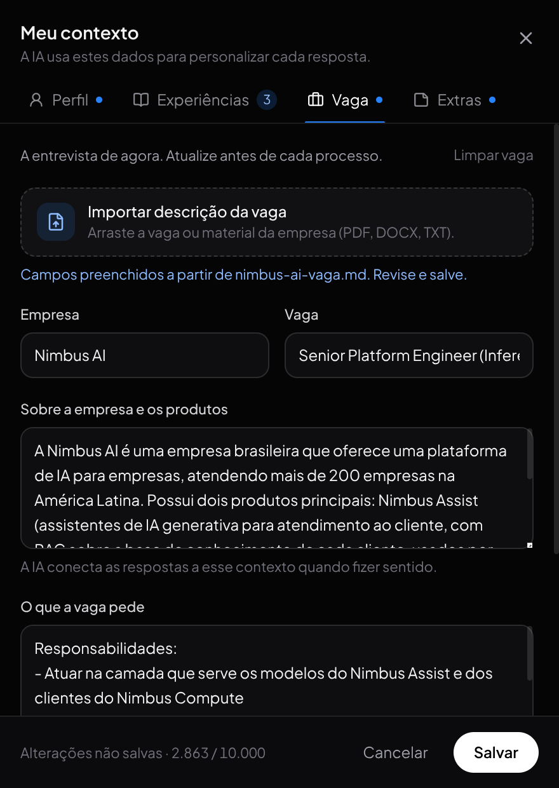

# Guia de uso

## Preparar uma entrevista

Abra o app com `npm start`. No menu (☰) da barra inferior, selecione em **Modelo** o provedor, o modelo e o nível de raciocínio, e em **Modo** a persona adequada: conversa geral, entrevista técnica, arquitetura, comportamental, RH, perguntas ao entrevistador ou vendas.

O app prepara a sessão do agente sem enviar uma pergunta. A disponibilidade dos modelos depende do CLI e da conta autenticada; o seletor contém uma lista definida no projeto.

## Meu contexto

O ícone de pessoa na barra inferior abre o editor em tela cheia. Um ponto azul no ícone indica que o perfil ainda está vazio. Preencha apenas fatos que você consiga sustentar na entrevista; campos vazios são ignorados.

| Aba | Campos |
| --- | --- |
| Perfil | **Importar currículo**, nome, cargo atual, anos de experiência, nível, **linguagem preferida**, tecnologias (Enter ou vírgula para adicionar) e resumo profissional. |
| Experiências | Até 8 histórias reais, cada uma com título e descrição (problema, o que você fez, resultado). |
| Vaga | **Importar descrição da vaga**, empresa, vaga, **sobre a empresa e os produtos**, requisitos e motivação. **Limpar vaga** apaga só essa aba, para a próxima entrevista. |
| Extras | Notas livres (pretensão, disponibilidade, inglês…), **Importar contexto.md** e a prévia do texto enviado à IA. |

### Importar currículo e vaga

Arraste um arquivo para a área **Importar currículo** (aba Perfil) ou clique nela para escolher. São aceitos PDF com texto selecionável, DOCX, TXT e MD, até 10 MB. O backend extrai o texto e pede ao provedor selecionado em **Menu → Modelo** que o organize nos campos: nome, cargo, nível, anos, linguagem preferida, tecnologias, resumo, até 8 experiências e, em Extras, formação, idiomas e links. A leitura costuma levar de alguns segundos a um minuto.

A área **Importar descrição da vaga** (aba Vaga) faz o mesmo com o anúncio da vaga ou um material sobre a empresa: preenche empresa, vaga, **Sobre a empresa e os produtos** e requisitos.

A importação só altera o rascunho do editor: revise os campos e clique em **Salvar**, ou cancele para descartar. Campos que o documento não traz mantêm o que você já tinha escrito, tecnologias são somadas à lista e o texto de Extras é acrescentado. Os campos preenchidos substituem os anteriores, e as experiências são trocadas pelas do currículo. Se o provedor falhar, o texto extraído vai para Extras (currículo) ou para **Sobre a empresa** (vaga), para que nada se perca.

A organização roda num processo separado do CLI, com o modelo selecionado e esforço baixo, então o documento não entra na conversa da entrevista. O texto do arquivo é enviado ao provedor; PDFs escaneados (só imagem) não têm texto para extrair.

### Contexto da empresa

Em **Sobre a empresa e os produtos**, descreva o que a empresa faz, seus produtos (por exemplo, de IA ou de infraestrutura), clientes, stack e o momento do time. As sugestões usam esse contexto para conectar a resposta aos produtos e desafios da empresa quando fizer sentido, sem forçar a ligação em toda fala e sem inventar fatos sobre ela.

  

A linguagem preferida (por exemplo, TypeScript) vira o padrão das soluções de código no chat e é citada nas sugestões faladas, a menos que a pergunta peça outra linguagem.

**Salvar** (ou Ctrl+S) grava todas as abas de uma vez. Fechar com alterações pendentes pede confirmação antes de descartar. O contexto completo aceita até 10.000 caracteres; o contador fica no rodapé.

O perfil é salvo pelo backend em `~/.local/share/interviewai/profile.json` (ou `$XDG_DATA_HOME/interviewai/profile.json`); no Windows, em `%APPDATA%\InterviewAI\profile.json`. O arquivo fica fora dos dados do Electron e do armazenamento do navegador, então continua disponível ao reiniciar o app, iniciar uma **Nova Sessão**, limpar os dados do app, trocar entre desenvolvimento e o pacote (AppImage ou Windows) ou reinstalar. A variável `INTERVIEWAI_PROFILE_PATH` troca o local. Um contexto salvo por versões anteriores no armazenamento local é migrado automaticamente para as notas na primeira abertura.

O contexto acompanha os pedidos de **Diga isso**, tanto automáticos quanto manuais. Mensagens digitadas e do microfone seguem o fluxo direto do agente e recebem apenas a linguagem preferida.

Para deixar de anexar o contexto, limpe os campos e salve. Isso não remove informações já enviadas à conversa do provedor. **Importar contexto.md** acrescenta o arquivo da raiz do projeto às notas; o app não escreve nesse arquivo e não acompanha alterações nele.

## Notas do Obsidian

**Menu → Notas** conecta uma vault do Obsidian. Escolha a pasta (ou digite o caminho) e clique em **Conectar**. O backend lê os arquivos `.md` da vault, ignora `.obsidian`, `.trash` e pastas ocultas, e monta um índice de busca em memória. Cada seção da nota (cada título `#`) vira um trecho. Edições, notas novas e exclusões são reindexadas automaticamente. A pasta escolhida fica em `notes.json`, ao lado do `profile.json`, e é reconectada ao abrir o app.

Durante a fala do PC, a transcrição parcial já é usada como busca. Quando aparecem trechos relacionados, um card verde **SUAS NOTAS** mostra a nota, a seção e o trecho com as palavras encontradas em destaque, antes de o modelo começar a responder. Ao consolidar a fala, os até 3 melhores trechos (no máximo 2.000 caracteres) vão no prompt do **Diga isso**, que deve usar os valores exatos das notas. Mensagens digitadas e do microfone também buscam nas notas, mostram o card e anexam os trechos.

A busca é por palavras (BM25), sem acentos e com variações simples, como plural e terminações de verbo ("liderou" encontra "liderei"). Ela não entende sinônimos: se a nota diz "p99" e a pergunta diz "percentil", a nota pode não aparecer. Use os títulos das seções para nomear o assunto. Conversa casual e perguntas sem relação não trazem trechos, e nesse caso o prompt fica igual ao de antes. Use **Testar uma pergunta**, na mesma tela, para conferir o que uma pergunta encontra.

São indexados até 5.000 arquivos de até 512 KB. Notas, anexos e imagens não saem do computador; só os trechos encontrados vão ao provedor, junto com a pergunta.

## Áudio e respostas

A captura do PC usa a saída de áudio padrão e tenta iniciar quando o app abre. No Linux, o backend lê o monitor da saída com `parec`; no Windows, a janela do Electron captura o loopback do sistema (o que está tocando nos alto-falantes ou fones) e envia o áudio ao backend pela conexão local. Os medidores permitem acompanhar e controlar a captura. A transcrição parcial aparece enquanto a pessoa fala, mas o modo automático só envia a fala consolidada ao modelo.

Após cerca de 900 ms de silêncio, o app encerra o trecho. Uma pausa no meio da pergunta também pode encerrá-lo: a detecção é baseada em áudio, sem análise semântica do fim da pergunta. Se isso atrapalhar a entrevista, desative o modo automático e use **Diga isso** após conferir a transcrição. O botão usa a última fala consolidada; ele não junta automaticamente vários trechos.

Áudio contínuo, como um vídeo ou música sem pausas, também é dividido: após 30 s de fala, o trecho é encerrado no primeiro momento mais baixo; se o áudio não baixar, ele é encerrado aos 45 s. Se o reconhecimento de um trecho falhar, o app descarta esse trecho e começa outro com o áudio seguinte, sem esperar uma pausa.

## Modo compacto

Ative pelo **Menu → Modo compacto** ou com **Alt+C** (app em foco). A janela encolhe no lugar e mostra só a última resposta do agente, com as configurações do menu, os medidores do PC e do microfone (clique no medidor do PC para ligar ou desligar a captura) e o botão para voltar ao modo normal. A abas, o feed de transcrição e a barra inferior ficam ocultos. Ao voltar, a janela recupera o tamanho anterior. A escolha é lembrada entre execuções.

O microfone grava uma mensagem para o agente. Clique para iniciar e parar, ou segure **Espaço** e solte para enviar. Digitar pelo botão de teclado também envia uma mensagem direta ao agente.

**Diga isso** pede uma fala pronta para responder ao interlocutor, em tom profissional e conversacional. Perguntas técnicas usam conhecimento geral mesmo quando o assunto não aparece no perfil. Perguntas hipotéticas recebem uma proposta no condicional, com passos e justificativa. Para experiências passadas, o modelo deve usar somente fatos informados: pode aproveitar uma experiência relacionada e indicar uma abordagem hipotética, sem transformar isso em uma história real. Dados pessoais ausentes, como salário ou disponibilidade, continuam exigindo confirmação.

O backend mantém uma janela limitada de falas consolidadas do PC e mensagens enviadas por texto ou microfone, inclusive com o modo automático desligado. Essa janela acompanha as sugestões para dar sentido a perguntas como “por quê?” ou “nesse projeto?”. Respostas da IA não são armazenadas nessa memória como fatos pessoais. Ela fica em memória durante a sessão, é compartilhada na troca de provedor e é apagada por **Nova Sessão** ou ao reiniciar o backend. O microfone continua sendo uma mensagem manual ao agente; ele não registra continuamente tudo o que você diz na chamada.

## Captura de tela

**Ctrl+Alt+S** envia uma captura do monitor ao agente como mensagem. Se não houver texto, o app pede a resolução da questão mostrada na tela (por exemplo, um exercício com enunciado e exemplos) e, se houver um editor com a assinatura da função, usa a mesma linguagem e assinatura. A janela do app é retirada da imagem durante a captura.

O monitor fica em **Menu → Captura**; clique para alternar entre **Auto · cursor** (o monitor onde está o cursor, padrão) e os monitores conectados. A escolha é lembrada entre execuções. Se o monitor escolhido estiver desligado, o app usa o do cursor. No Linux, o nome dos monitores vem de `xrandr`.

A imagem é reduzida para no máximo 1920 px no maior lado e enviada em JPEG. Uma mensagem aceita até 4 imagens. No feed, a captura aparece como sua mensagem; a memória da conversa guarda somente um marcador, não a imagem.

## Atalhos

| Atalho | Ação | Disponibilidade |
| --- | --- | --- |
| Alt+Space | Alternar microfone | Global no Electron e app em foco |
| Ctrl+D | Pedir uma sugestão para a última fala | Global no Electron |
| Ctrl+B | Ocultar ou mostrar a janela | Global no Electron |
| Ctrl+Alt+P | Alternar captura do PC | Global no Electron |
| Ctrl+Alt+M | Alternar microfone | Global no Electron |
| Ctrl+Alt+N | Iniciar nova sessão | Global no Electron |
| Ctrl+Alt+S | Enviar captura da tela ao agente (monitor escolhido em **Menu → Captura**; padrão: o do cursor) | Global no Electron |
| Alt+N ou Ctrl+Shift+R | Iniciar nova sessão | App em foco |
| Alt+C | Alternar modo compacto | App em foco |
| Ctrl+= / Ctrl+- / Ctrl+0 | Aumentar, diminuir ou restaurar o texto do feed (faixa de 70% a 200%, lembrada no app) | App em foco |
| Espaço, segurando | Gravar pelo microfone; soltar envia | App em foco, fora de campos de texto |

Atalhos globais podem conflitar com o ambiente desktop ou com outros programas (no Windows, Ctrl+D e Alt+Space ficam reservados ao app enquanto ele está aberto); no Linux, Alt+Shift costuma ser a troca de layout de teclado, por isso os atalhos globais usam Ctrl+Alt. Os botões da interface continuam disponíveis.

## Dados e limites

O reconhecimento usa o serviço Google por meio da biblioteca Python `SpeechRecognition`. Portanto, a transcrição não é offline. O texto reconhecido e o contexto salvo são enviados ao provedor quando uma sugestão é solicitada.

Currículos e descrições de vaga importados são enviados ao provedor uma vez, para organizar os campos; o arquivo não é guardado pelo app, apenas o perfil que você salvar.

Dos arquivos da vault do Obsidian, só os trechos encontrados para cada pergunta vão ao provedor.

Capturas de tela são enviadas ao provedor somente quando você usa Ctrl+Alt+S; não há captura contínua. Com o Antigravity, que recebe apenas texto no fluxo do agente, a imagem é gravada como arquivo temporário em `interviewai-screenshots` na pasta temporária do sistema e removida após 1 hora. Quem tiver acesso a essa pasta na máquina pode ler a captura durante esse período. Por isso, evite capturar telas com dados sensíveis que não devam ir ao provedor.

Os CLIs usam a autenticação já configurada na máquina. O fluxo de mensagens diretas pode executar ferramentas do agente; a instrução para responder sem ferramentas pertence ao prompt do copiloto, não é um isolamento de segurança.

Erros de reconhecimento aparecem na interface e impedem o envio daquela transcrição incompleta. Rede lenta, fila de reconhecimento e geração do modelo podem aumentar a espera. Consulte o [diagnóstico de latência](response-latency.md).
